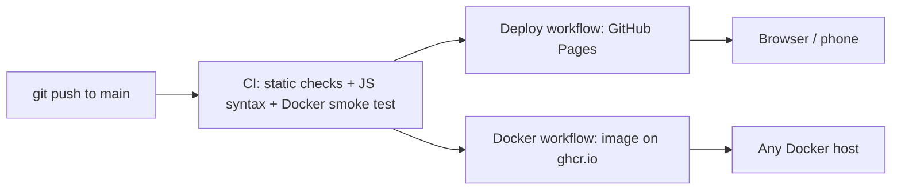

# recmin - Voice-Announced Recording Timer (with CI/CD and Docker)

[](https://github.com/jaswanthkumarj1234-beep/recmin/actions/workflows/ci.yml)
[](https://github.com/jaswanthkumarj1234-beep/recmin/actions/workflows/deploy.yml)
[](https://github.com/jaswanthkumarj1234-beep/recmin/actions/workflows/docker-publish.yml)

**Live app:** https://jaswanthkumarj1234-beep.github.io/recmin/

## The problem

People who record AI training-data videos wear headphones while they record and cannot see a clock. Their client allows **no more than 25 minutes per video**, so they either stop too early or run over and the recording is rejected.

recmin fixes that. The recorder presses start (or says a start command), hears a spoken countdown, and then the app counts up and **announces the time out loud**: 5, 10, 15 and 20 minutes completed, "1 minute to go", and "Time is up". On phones it also vibrates with a different pattern for each announcement. The recorder never has to look at a screen.

It was built for a real user: a friend who does this work part-time.

## DevOps practices in this project

| Practice | How it is done here |
|---|---|
| Continuous integration | GitHub Actions runs static checks, a JavaScript syntax check and a Docker smoke test on every push and pull request |
| Quality gate before release | The deploy workflow only publishes if the checks pass |
| Continuous deployment | Push to `main` deploys to GitHub Pages automatically (no manual upload) |
| Containerization | Dockerfile on a non-root nginx image, with a health check |
| Artifact publishing | Docker image pushed to GitHub Container Registry with `latest`, commit-SHA and semantic-version tags |
| Container hardening | Non-root user, read-only filesystem and all Linux capabilities dropped in Compose, security headers in nginx |
| Dependency management | Dependabot updates GitHub Actions and the base image weekly |
| Reproducible local workflow | `make test`, `make serve`, `make docker-run`, `make compose-up` |
| Release management | Semantic version tags, `CHANGELOG.md`, GitHub Releases |
| Documentation | This README, with architecture diagram and run instructions |

## Features

- Spoken countdown and milestone announcements from 69 pre-recorded voice clips (does not depend on the browser's speech engine)
- Voice start command: native Web Speech API, or an **offline** Vosk model running in the browser (used in Brave)
- Keeps running in the background: Web Worker ticker, silent keep-alive audio, Screen Wake Lock
- Catches up after throttling: every missed milestone is announced in order
- Background alerts through a service worker notification, with a different vibration pattern per milestone (Android)
- Asks for confirmation before the page is reloaded or the tab is closed, so a recording timer is never lost by accident

## Architecture

A static site: one HTML file, a service worker, audio clips and the Vosk assets. No backend, no build step.



## CI/CD workflows

| Workflow | Trigger | What it does |
|---|---|---|
| `ci.yml` | push, pull request | Runs `tests/check_site.py`, checks JavaScript syntax with Node, builds the Docker image, starts it and probes `/healthz`, `/`, cache headers and a clip |
| `deploy.yml` | push to `main` | Runs the checks as a gate, assembles only the files the browser needs, deploys to GitHub Pages |
| `docker-publish.yml` | push to `main`, tags `v*` | Builds and pushes `ghcr.io/jaswanthkumarj1234-beep/recmin` with layer caching |
| Dependabot | weekly | Keeps GitHub Actions and the base Docker image up to date |

## What the checks cover (`tests/check_site.py`)

HTML tags balanced, no duplicate ids, every `$('id')` used in the script exists in the markup, all 69 voice clips present and non-empty, service worker and Vosk assets present, reload guard present, script brackets balanced. Standard library only. These are static checks; the voice and vibration features were tested by hand on real devices.

## Run it

```bash
make serve                 # plain static server, http://localhost:8080
make test                  # run the checks
make docker-run            # build and run the container, http://localhost:8080
make compose-up            # compose with read-only filesystem and dropped capabilities

# pull the published image
docker run --rm -p 8080:8080 ghcr.io/jaswanthkumarj1234-beep/recmin:latest
```

## Project layout

```
index.html            app (UI, timer, voice, vibration)
sw.js                 service worker for background notifications
clips/                69 pre-recorded voice clips
vosk/                 offline speech recognition (Vosk) library and model
tests/check_site.py   static checks used by CI
Dockerfile, nginx.conf, docker-compose.yml
.github/workflows/    ci.yml, deploy.yml, docker-publish.yml
CHANGELOG.md
```

## Limits

A web page cannot vibrate on iPhone, and laptops have no vibration motor. Reliable background sound on phones depends on the browser; the notification path is the fallback.

## How it was built

Designed and iterated from real use (for example, the "announce every missed milestone" fix came from a real test where the 5-minute call was skipped). Developed with AI assistance from Claude (Anthropic) for code and pipeline authoring; requirements, testing on real devices and deployment decisions are by the project owner.

## License

MIT
