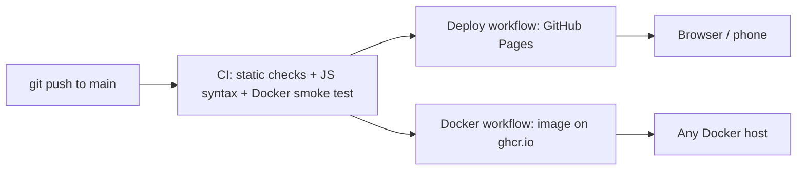

# recmin - Record Minutes Timer

[](https://github.com/jaswanthkumarj1234-beep/recmin/actions/workflows/ci.yml)
[](https://github.com/jaswanthkumarj1234-beep/recmin/actions/workflows/deploy.yml)
[](https://github.com/jaswanthkumarj1234-beep/recmin/actions/workflows/docker-publish.yml)

**Live:** https://jaswanthkumarj1234-beep.github.io/recmin/

A voice-triggered countdown timer for video recording. You say a start command (or press a button), it counts down out loud, says "Video started", then counts **up** while you record and announces 5, 10, 15, 20 minutes and so on, "1 minute to go", and "Time is up".

## Features

- Spoken countdown and milestone announcements from 69 pre-recorded voice clips (no dependency on the browser's speech engine)
- Voice start command, either native Web Speech API or an **offline** Vosk model running in the browser (used in Brave)
- Keeps running in the background: Web Worker ticker, silent keep-alive audio, Screen Wake Lock
- Catches up after throttling: every missed milestone is announced in order
- Background alerts through a service worker notification, with a different vibration pattern per milestone (Android)
- Asks for confirmation before the page is reloaded or the tab is closed, so a recording is never lost by accident

## Architecture

It is a static site: one HTML file, a service worker, audio clips and the Vosk assets. No backend and no build step.



## CI/CD

| Workflow | Trigger | What it does |
|---|---|---|
| `ci.yml` | push, pull request | Runs `tests/check_site.py`, checks JavaScript syntax with Node, builds the Docker image, starts it and probes `/healthz`, `/`, cache headers and a clip |
| `deploy.yml` | push to `main` | Runs the checks as a gate, assembles only the files the browser needs, deploys to GitHub Pages |
| `docker-publish.yml` | push to `main`, tags `v*` | Builds and pushes `ghcr.io/jaswanthkumarj1234-beep/recmin` (`latest`, short SHA, semver tags) with layer caching |
| Dependabot | weekly | Keeps GitHub Actions and the base Docker image up to date |

## What the checks cover (`tests/check_site.py`)

HTML tags balanced, no duplicate ids, every `$('id')` used in the script exists in the markup, all 69 voice clips present and non-empty, service worker and Vosk assets present, reload guard present, script brackets balanced. Standard library only.

## Run it

```bash
# plain static server
make serve                 # http://localhost:8080

# tests
make test

# Docker (nginx, non-root, health check)
make docker-run            # http://localhost:8080

# docker compose (read-only filesystem, all capabilities dropped)
make compose-up

# pull the published image
docker run --rm -p 8080:8080 ghcr.io/jaswanthkumarj1234-beep/recmin:latest
```

## Container hardening

- `nginx-unprivileged` base image, runs as non-root on port 8080
- `HEALTHCHECK` against `/healthz`
- Compose: read-only root filesystem, `cap_drop: ALL`, `no-new-privileges`
- `no-cache` on `index.html` and `sw.js` so new versions roll out immediately; long cache for clips and the voice model
- `nosniff`, `Referrer-Policy` and `Permissions-Policy` headers

## Project layout

```
index.html            app (UI, timer, voice, vibration)
sw.js                 service worker for background notifications
clips/                69 pre-recorded voice clips
vosk/                 offline speech recognition (Vosk) library and model
tests/check_site.py   static checks used by CI
Dockerfile, nginx.conf, docker-compose.yml
.github/workflows/    ci.yml, deploy.yml, docker-publish.yml
```

## Limits

A web page cannot vibrate on iPhone, and laptops have no vibration motor. Reliable background sound on phones depends on the browser; the notification path is the fallback.

## License

MIT
